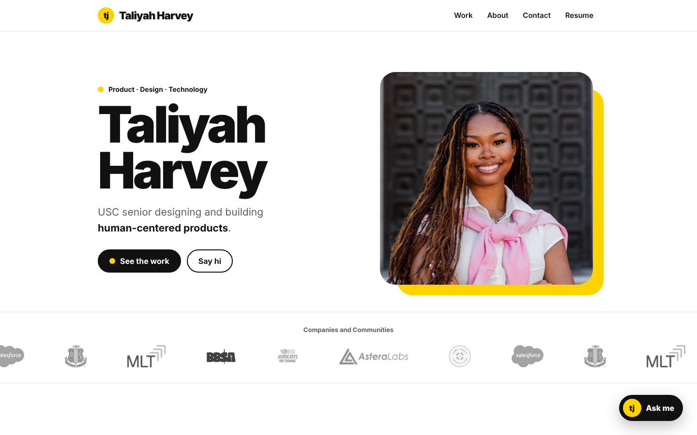

<p align="center"></p>

# taliyahharvey.com

My portfolio. Six projects, each with its own process page: the problem statement, how it went, and what I'd do differently.

**[Visit the site](https://taliyahharvey.com)**

## What's in it

- **Selected Work:** In Hindsight, Bite Back, Karl's Friend Bart, Fee Fi Fo Fund and Branch Out
- **Class Projects:** The Hangout (with a flip-through version of our toolkit) and Eruca
- **Connect the Dots:** three Flow-style puzzles I generated with a SAT solver
- **Ask tj:** pre-written answers to common questions, in a professional or casual voice

## How it's built

Plain HTML, CSS and JavaScript on GitHub Pages. No framework, no build step for the home page. The process pages in `work/` are generated by `work/build_pages.py` so they all share one format.

```bash
python3 -m http.server 8000   # then open localhost:8000
cd work && python3 build_pages.py   # rebuild the process pages
```
